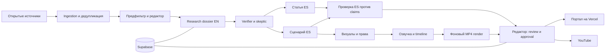

# HLD v0.2 — Dobrov Academy: научный портал и AI-редакция с видео в MVP

Дата: 21 октября 2026. Статус: архитектура для старта реализации, с отмеченными открытыми решениями. Основание: HLD v0.1 и три приложенных обсуждения. Последние ответы пользователя имеют приоритет над исходными вариантами.

## 1. Продукт

Название для реализации — **Dobrov Academy**. Основной планируемый домен `dobrov.org`, дополнительный `dobrow.org` после подключения перенаправляется на основной. Первый брендинг — `BRAND.md`; домены пока не подключены.

Бесплатный испаноязычный научный портал для образованных неспециалистов. Его ценность — отбор действительно значимых сюжетов, разбор доказательств, объяснение ограничений и связь новостей с базовыми концептами. AI-first означает, что агенты выполняют основную редакционную работу, а код задаёт проверяемые границы и сохраняет историю решений.

Публикации: нейтральный испанский. Первичные источники, канонические claims и dossier: английский. AI 70% / фундаментальная физика и космос 30%; 10–20 историй в неделю. Из лучших историй — 2–3 видео в неделю по 8–12 минут. Это целевые объёмы, а не обещание производительности текущего каркаса.

Видео входит в MVP. Формат: без ведущего, испанская AI-озвучка, реальные научные материалы с правами использования, схемы, диаграммы, субтитры. Генеративные иллюстрации применяются для объяснения и маркируются. Производственная логика референса Anton Petrov — выбор темы, контекст и ясное объяснение; личность, голос и оформление автора не воспроизводятся. Статистика канала из приложений не используется как архитектурный факт.

## 2. Как объединены варианты

| Различие | Единое решение |
|---|---|
| Исходный HLD откладывает видео | Видео — обязательный вертикальный срез MVP |
| Видео-обсуждение ставит YouTube первым | Веб — каноническая статья и evidence; YouTube — полноценный канал MVP |
| Одно обсуждение предлагает physics + space + AI без квот | Сохранены AI 70% / физика 30%; космос входит в физику |
| Числовая LLM confidence | Категориальная доказательность; score отбора отделён от научной надёжности |
| Стремление к быстрой автономии | MVP в shadow mode и с подтверждением человеком; дальнейшая автономия по eval |
| Несколько независимых производств | Один dossier → статья + сценарий + описание + ссылки |
| Простой cron против долгих видео-задач | Postgres queue + отдельный worker; веб не исполняет длительный render |
| Google как широкий стек | Только Gemini и YouTube, по прямому ответу пользователя |

Telegram и 1–2 соцсети остаются в расширенном плане. До выбора каналов их реализация не блокирует основной MVP: портал + YouTube. Рассылка, Shorts и аналитическое обучение — следующий этап.

## 3. Обязательный объём MVP

1. Открытые источники по двум областям, нормализация DOI/arXiv и дедупликация.
2. Дешёвый предфильтр, многомерный ranking и редактор с квотами, объяснением решений и эталонной разметкой Дениса.
3. Research dossier: результат, метод, доказательства, контекст, альтернативные интерпретации, ограничения, что авторы не утверждают.
4. Независимый verifier и skeptic, проверяющие claims относительно цитат. Поставщик verifier отличается от Gemini; пока не выбран.
5. Испанская статья и сценарий из одобренных claims; последующая сверка языка и научного смысла.
6. Visual plan, права на assets, TTS, timeline, монтаж, MP4, SRT, описание/главы/источники YouTube.
7. Редакционная консоль: просмотр, правка, повтор стадии, reject/hold, review, approval; публикация только после проверки.
8. Публичный портал: статья, evidence, связанные концепты, политика AI и исправления.
9. Публикация web + YouTube, версии и исправления во всех активных каналах.

Вне MVP: медицина, мобильное приложение, персонализация, AI-avatar, генерация целого видео одной моделью, отдельная графовая СУБД, оптимизация отбора по CTR.

## 4. Архитектура

Это детерминированный workflow с ограниченными агентными шагами. Исследователь может планировать поиск в пределах allowlist; он не получает права публикации, доступа к секретам и самостоятельного изменения политики.

**Vercel:** Next.js App Router, публичные страницы, позднее защищённая редакция и короткие API-команды. **Supabase:** Postgres, Auth, приватный Storage, очередь/состояние, граф в таблицах. **Worker:** TypeScript и Docker, локально на старте или у отдельного выбранного хостера. **Google:** Gemini API для исследований и текста, YouTube Data API для канала. Провайдер озвучки и независимый verifier выбираются после короткой оценки качества/стоимости.

Уточнение PR2: облачный Supabase — существующий **To-do-Db-project** (`upwrplsgunjanragbggb`), выбран пользователем для сохранения бесплатного плана. Новые сущности живут в `academy`, Storage — в `dobrov-academy-assets`; старые данные/настройки не сбрасываются. Auth и ресурсы общие на уровне проекта. Локальная разработка использует отдельный Docker stack на 563xx, обычные Vercel Preview до отдельного решения остаются demo. Детали установки — `SUPABASE.md`.

У Vercel Functions ограничено время выполнения; длинный render вынесен в worker. Это не требует выбора конкретного дополнительного облака на Sprint 0. Worker не живёт в HTTP-запросе страницы. Для первого MVP достаточно Postgres lease queue; переход на durable engine — при усложнении ретраев/ожиданий. [Vercel Functions](https://vercel.com/docs/functions/limitations).

## 5. Данные и lineage

`Source → ScientificStory → ResearchDossier → Claim ↔ Evidence → Article / Script → ContentAsset → Publication`. Дополнительно: `Concept`, рёбра `requires` и `follows_up/confirms/disputes`, `EditorialDecision`, `Correction`, `ProductionJob`, `AgentRun`.

Source хранит канонический ID, вид источника, доступность текста и известную лицензию. История объединяет публикации об одном событии. DOI и версии arXiv нормализуются до общей идентичности; семантическая кластеризация — позднее, после надёжного точного matching.

Claim имеет тип `measured_result`, `author_interpretation`, `vendor_claim`, `editorial_explanation` или `speculation`. Evidence содержит короткую точную цитату, source ID, location и время доступа. Наличие ссылки не означает верификацию: verifier проверяет, что цитата существует и поддерживает именно формулировку claim.

Статья: версионированные параграфы ES с claim IDs. Сценарий: narration ES, длительность, цель/visual intent и claim IDs на каждую сцену. Версии утверждённого материала неизменяемы. Повторная генерация создаёт новую версию и требует нового approval. Publication фиксирует версии, канал, remote ID, idempotency key и статус.

Граф знаний в MVP — таблицы Postgres. Concept имеет Wikidata QID, глоссарий EN/ES и ссылки на Wikipedia. Своя страница концепта появляется после нескольких реальных публикаций, начальное допущение — 3; глубина prerequisite для читателя — до 2 шагов.

## 6. Научные и редакционные правила

Физика: P0 — теория; P1 — препринт с данными; P2 — рецензированный результат; P3 — независимое подтверждение; P− — оспорено. AI: A0 — анонс; A1 — отчёт вендора; A2 — независимая оценка; A3 — подтверждённое применение; A− — оспорено. Эти шкалы не смешиваются и не превращаются в числовую confidence.

Ranking оценивает значимость, новизну, интерес аудитории, объяснительную ценность, визуальный потенциал, актуальность, качество источника и hype risk. Формула и причины версионируются; окончательные веса определяются на эталоне, не выдаются за доказанную модель.

P0/A0 требуют явных оговорок; экстраординарные утверждения ниже P2/A2 удерживаются для ручного разбора. Медицинские пересечения всегда удерживаются. Не добираем недельную квоту слабыми сюжетами.

Writer работает только с утверждённым dossier и глоссарием. Проверка испанского ловит добавленные факты, потерю caveats и ошибки терминов; носитель языка проверяет выборку. Заголовки, thumbnails и описания проходят те же правила, что статья и narration.

## 7. Видео как отдельный производственный контур

Форматы сцены: real asset, paper figure, diagram, chart, generated illustration, text. Научные изображения не считаются свободными только по месту публикации: проверяются права конкретного asset. Сгенерированное объяснение не изображает реальную запись наблюдения.

`Script → VisualPlan → rights review → TTS → timings → timeline → captions → render → audiovisual QA → approval`. Длительности финальной timeline определяются по фактической озвучке; короткий demo storyboard не претендует на 8–12 минут. Для MVP — FFmpeg и простые шаблоны; Remotion можно рассмотреть отдельным ADR, если нужны сложные анимации.

Проверки видео: смысл narration, произношение терминов, синхронизация, читаемость субтитров, отсутствие пустых кадров, уровни звука, атрибуция, источники, маркировка синтетической речи. YouTube сначала получает private upload, затем явно утверждённый выпуск. OAuth и resumable upload обязательны для реального адаптера. [YouTube upload guide](https://developers.google.com/youtube/data/guides/uploading_a_video).

## 8. Оркестрация и надёжность

Stage input/output имеет схему и version. ProductionJob имеет unique idempotency key, attempts, available_at, lease token и deadline. Claim через `FOR UPDATE SKIP LOCKED`; finish/fail принимают только действующий lease. Платные операции требуют ledger/reservation до вызова. Неизвестная стадия удерживается, а не отмечается выполненной.

Для долгих render нужен heartbeat/renew lease либо разбиение на короткие подзадачи — это обязательная задача до production. Повторы внешних публикаций сверяют remote outcome; нельзя повторять upload после неоднозначного таймаута без reconciliation. Исправления распространяются по Publication; где редактирование невозможно, выпускается заметное уведомление, для видео также оценивается необходимость снятия/перевыпуска.

Каждый AgentRun сохраняет provider/model, prompt/policy version, input hash, output, tokens, latency, cost. Секреты и OAuth tokens не попадают в traces. Исходные документы считаются untrusted input. Gemini structured output проверяется локальной схемой; схема не заменяет научную верификацию. [Gemini structured output](https://ai.google.dev/gemini-api/docs/structured-output).

## 9. Доступ и публикация

Аноним видит только опубликованные статьи и исправления. Пользователь Supabase Auth без editor membership не получает редакционные данные. Worker service-role key хранится только server-side. Assets в приватном bucket, previews — через ограниченные signed URLs после авторизации. [Supabase RLS](https://supabase.com/docs/guides/database/postgres/row-level-security).

Release gate использует сохранённые результаты verifier/language review и доверенную запись человеческого approval, привязанную к версиям. Клиентский флаг `approved=true` не является разрешением. В текущем каркасе live publishing отсутствует; UI использует только синтетические fixtures и может быть открыт без аккаунта.

## 10. Автономия и качество

Начальный режим — shadow: агент выбирает, Денис независимо размечает и проверяет. Ориентир исходного HLD — 3–4 недели и 2–4 часа в неделю; это проверяемая гипотеза нагрузки, особенно с видео. Метрики: recall предфильтра, согласие отбора, ошибки типизации/provenance, пропуски verifier, ES alignment, исправления на 10 сюжетов, стоимость статьи/видео и время человека.

Переход к full audit / sampling — отдельно по DomainPack, после определённых порогов и регрессии на эталоне. В MVP выпуск подтверждается до публикации. Аналитика аудитории подключается после накопления метрик точности и не отменяет научные ограничения.

## 11. Бюджет

Подтверждён ориентир $100–300/месяц на AI и видео. Для настройки каркаса — плановый envelope $200, не рассчитанная стоимость. Два–три ролика в неделю — примерно 8–13 в месяц, поэтому TTS, assets и render проверяются коротким пилотом до обещания такой частоты.

Лимиты на месяц, сюжет и видео задаются конфигурацией. Сначала фильтр правилами, затем дешёвый анализ аннотаций, глубокая работа только для выбранного пула. При нехватке бюджета — hold с причиной; нельзя молча снижать доказательность или заменять полную работу аннотацией. Инфраструктурные подписки, домен и труд редактора считаются отдельно, пока пользователь не уточнит включение в этот envelope. Тарифы вендоров не фиксируются без проверки на момент подключения.

## 12. Права, прозрачность и исправления

Портал открыто сообщает о применении AI, роли человека, моделях и уровнях доказательности. Публикует историю исправлений, сохраняет версии. Полные тексты и assets обрабатываются по условиям каждого источника и лицензии; отсутствие paywall не означает право повторной раздачи.

Юридические формулировки и даты из исходного HLD не переносятся как подтверждённое заключение: до публичного запуска нужен отдельный разбор применимых условий источников, платформ и страны оператора. Текущий HLD задаёт продуктовую политику прозрачности и трассируемости.

## 13. Вертикальные срезы и итоговый DoD MVP

S0 — данный каркас и demo. S1 — источники/очередь. S2 — защищённая редакция, выбор и эталон. S3 — dossier, независимая проверка, статья и сценарий ES. S4 — реальная озвучка, визуалы и MP4. S5 — web + private YouTube upload + утверждённый выпуск и исправления.

MVP готов, когда реальный DOI/arXiv проходит весь путь до опубликованной испанской статьи и проверенного видео, каждый claim/scene имеет evidence, права на assets зафиксированы, ошибка блокирует выпуск, повтор задачи не создаёт дублей, исправление доходит до обоих каналов, стоимость видна, человек утверждает конкретные версии. Этот критерий шире выполненного Sprint 0.
